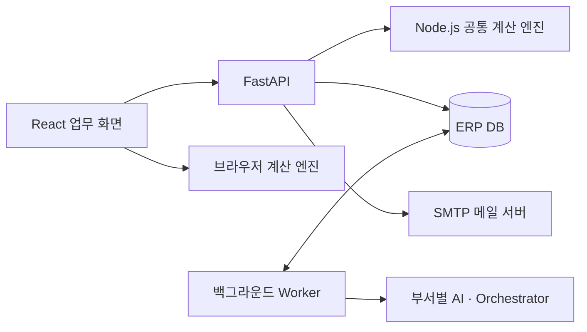

# BioFlow ERP

바이오 제조 원료의 재고, 생산계획, 공급업체 견적, 품질 상태와 구매예산을 연결하는 웹 ERP입니다. 결정론적 계산 엔진이 수량·일정·비용을 산출하고, 부서별 AI와 Orchestrator가 계산 근거를 검토하여 담당자의 발주 의사결정을 지원합니다.

## 기술 스택

| 영역 | 구성 |
| --- | --- |
| 프론트엔드 | React 19, TypeScript, Vite 6, Tailwind CSS, Radix UI |
| 업무 계산 | TypeScript 공통 엔진, Node.js 서버 실행 번들 |
| 백엔드 | FastAPI, Pydantic, SQLAlchemy 2, Alembic |
| 데이터베이스 | PostgreSQL, 로컬 실행용 SQLite |
| AI 연동 | OpenAI, Gemini, OpenRouter, vLLM, OpenAI 호환 서버 어댑터 |
| 문서·통신 | ExcelJS 기반 XLSX, CSV, 인쇄용 발주서, TLS SMTP |
| 검증 | Vitest, pytest |

## 시스템 구조



브라우저와 서버는 동일한 TypeScript 업무 엔진을 사용합니다. 서버는 업무 상태와 데이터 버전을 검증한 뒤 DB에 저장하며, 시간이 필요한 AI 검토·외부 자료 수집·계획 재계산은 DB 작업 큐와 Worker가 처리합니다. AI 검토 진행 상태는 SSE로 전달합니다.

## CSV 기반 자동 감지·견적 요청

**CSV · 자동 감지 · 견적** 화면에서 6종 CSV 원본을 검증·적용하고 생산계획을 추가할 수 있습니다. 원료별 부족량, 안전재고 보충량, 품질 승인 기간과 공급 리드타임을 계산하며 데이터 변경 시 알림과 승인 유효성을 재검증합니다. 견적 요청 승인 → 업체별 초안 → 수신처·수량·일정 확인 → 최종 발송 승인 → 처리 이력을 연결합니다. 시뮬레이션 모드는 외부 통신 없이 같은 승인·버전·중복 검증을 실행합니다.

CSV 형식과 Gmail MCP 서버 구성은 [CSV·자동 견적 기술 문서](docs-team/CSV-RFQ.md)를 참고하세요.

## ERP 업무 모듈

| 모듈 | 주요 기능 |
| --- | --- |
| 원료·Lot 재고 | 원료 코드, 수량, 유효기간, QC/QA 상태, 보류 사유, 생산 가용량 관리 |
| 생산·납기 계획 | 생산별 원료 수요, 투입일, 고객 납기, 후속 공정 기간과 부족 영향 계산 |
| 공급업체·견적 | 단가, MOQ, 주문배수, 확약 수량, 분할 입고일, 운송비, 견적 유효기간 관리 |
| 구매요청·승인 | 부족 알림, 공급업체 확인 승인, 추천 검토, 최종 발주 승인 |
| 발주·입고 | PO 생성, ERP 등록, 회차별 출하·입고·검사 상태, 생산 투입 반영 |
| 품질 검토 | 품질 보류와 사용 승인 구분, 검사 지연 및 유효기간에 따른 투입 가능 여부 계산 |
| 재무 검토 | 구매·운송 소계, 시험·보관·폐기 비용, 예산·지급일별 현금 한도 비교 |
| 이력·문서 | 원본 변경, 분석 근거, 승인·발주 이력, CSV/XLSX 내보내기, 발주서 인쇄 |

업무 목록은 검색·필터·정렬·페이지 이동과 셀 선택을 지원합니다. 행 상세와 분석 근거는 Drawer에서 조회하고, 승인은 별도 확인 모달에서 처리합니다.

## 계산 및 검증 규칙

- **가용재고:** Lot별 품질 상태와 생산 투입 시점의 유효기간을 확인합니다. 보류·미승인 Lot는 제외하고, 날짜별 생산 수요를 순서대로 할당합니다. 현재 재고와 미래 확약 입고를 구분합니다.
- **확보 수량:** 생산 부족량과 안전재고 보충량을 구분하고, 공급업체별 MOQ·주문배수·확약 수량에 맞춰 주문 대안을 계산합니다. 미확약 공급량은 확정 공급에 포함하지 않습니다.
- **사용 가능일:** 입고일에 QC 검사 기간, QC 시작 지연, QA 검토 기간을 반영합니다. 생산 투입일 이후 사용 가능한 물량은 해당 생산에 할당하지 않습니다.
- **공급 전략:** 일괄·분할·부분 공급의 입고 일정, 생산 충족 여부, 잔여재고와 유효기간에 따른 폐기 위험을 비교합니다.
- **비용:** 구매금액과 운송비의 소계를 먼저 산출하고 시험·보관·폐기처리 비용을 더해 예상 총비용을 계산합니다. 폐기 재고의 구매원가를 중복 합산하지 않습니다.
- **변경 검증:** 수량·단가·MOQ·일정·검사 지연 변경 시 데이터 버전과 fingerprint를 갱신합니다. 기존 추천·회신·승인 범위의 유효성을 다시 확인합니다.

날짜 계산은 달력일 기준입니다. 영업일·공휴일, 원료 규격·단위 변환 및 비용 정책은 도입 사업장의 기준정보에 맞춘 확장이 필요합니다.

## Multi-Agent 검토와 승인

재고·생산계획, 구매, 품질, 재무 AI가 동일한 ERP 스냅샷을 독립적으로 검토합니다. 각 결과에는 후보 대안, 판단 근거, 제약, 미확인 조건과 참조 데이터 ID를 포함합니다. Orchestrator는 결과를 수집하고 조건 충돌이 있으면 해당 역할에 추가 검토를 요청한 뒤 최종 추천을 구성합니다.

수량·비용 계산은 업무 엔진이 담당하고, AI 응답은 Pydantic·JSON Schema로 검증합니다. 외부 LLM 검토에는 공급자·모델 설정이 필요하며, 설정 누락이나 호출 실패를 임의의 AI 응답으로 대체하지 않습니다. 역할별 공급자·모델·타임아웃은 `LLM_ROLE_MAPPING`으로 지정할 수 있습니다.

업무 흐름은 다음과 같습니다.

```text
부족 감지 → 공급업체 확인 승인 → 공급 조건 수집 → 부서별 독립 분석
→ Orchestrator 검증 → 담당자 최종 승인 → PO 등록 → 출하·입고·QC·QA 추적
```

공급업체 확인 승인과 구매 발주 승인은 별도 상태입니다. PO 등록 시 데이터 버전, 견적 유효기간, 확약 조건과 기존 발주를 다시 확인합니다. 등록된 PO의 승인 당시 제품·단가·수량·금액·일정은 스냅샷으로 보존하며, 구매 승인이 품질 사용 승인을 대신하지 않습니다.

## 데이터 저장 및 권한

브라우저 업무 초안은 localStorage에 저장합니다. 서버 저장은 명시적인 동기화로 수행하며, `expected_revision`이 서버 버전과 다르면 HTTP 409로 충돌을 반환합니다. 서버는 공통 엔진으로 계산을 재실행하고 업무 상태를 ERP 컬렉션에 투영하여 저장합니다.

DB는 ERP 원본, 분석 실행·산출물, 추천, 승인, 작업 큐, 감사 기록과 메일 발송 이력을 관리합니다. Alembic으로 스키마를 이관하며 동일 추천·승인 요청의 중복 처리를 제약조건과 idempotency key로 방지합니다. 브라우저 저장은 최근 보고서 12개, 업무 로그 400개, 알림 100개로 제한되므로 장기 보존은 서버 DB를 기준으로 설계해야 합니다.

계정 역할은 `operator`와 `approver`로 구분합니다. 비밀번호는 scrypt로 해시하고, 서버 세션은 HttpOnly·SameSite 쿠키를 사용합니다. 최종 승인·추천 채택·메일 발송에는 승인자 권한이 필요하며, 상태 변경 API는 요청 Origin을 검사합니다.

## 공급업체 견적 메일

견적 요청 본문과 CSV 회신 양식은 ERP 원료·수량·생산 일정에서 생성합니다. 사용자는 공급업체, 발신·수신 주소, 제목과 본문을 확인·수정한 뒤 SMTP 전송을 요청합니다.

서버는 승인자 권한, 이메일 형식, 허용 발신 주소와 idempotency key를 검증하고 TLS SMTP로 전송합니다. 발송 이력에는 업체, 발신·수신 주소, 제목, 처리 상태와 Message-ID를 저장합니다. 최종 승인한 본문·수량·일정·원본 버전은 요청 스냅샷으로 저장하고 SMTP/OAuth 자격증명은 이력에 저장하지 않습니다.

발신·수신 기본 주소는 서버 환경변수에서 읽습니다. Gmail 인증정보가 없으면 메일 작성 화면에서 앱 비밀번호로 연결할 수 있습니다. 인증을 확인한 자격증명은 접근 권한을 제한한 `.runtime/mail.env`에 저장하며, 연결 확인 중에는 메일을 발송하지 않습니다.

SMTP 수락 상태와 최종 수신·회신 상태는 구분됩니다. Gmail MCP 모드에서는 수신처·요청번호·스레드가 일치하는 회신을 조회합니다. 담당자가 구조화된 견적 조건을 확인한 뒤 구매 AI에 전달하며, 실제 발송 업체의 회신을 가상 확약으로 대체하지 않습니다.

## 프로젝트 구성

```text
src/
  workflow/           업무 상태 전이, 승인, PO, 후속 추적, 기본 업무 화면
  erp/                원료·Lot 모델, 재고·일정·비용 계산, 데이터 그리드
  connected/          서버 동기화, AI 검토·외부 이슈 화면, API 클라이언트
backend/
  app/
    services/         계획·분석·승인·업무 저장·메일·외부 자료 처리
    providers/        LLM 공급자 어댑터와 구조화 응답 검증
    models.py         SQLAlchemy 데이터 모델
    schemas.py        API·AI 응답 스키마
    main.py           REST API, 인증, SSE, 웹 정적 파일 제공
    worker.py         DB 작업 큐 실행과 작업 lease 관리
  migrations/         Alembic 마이그레이션
  tests/              백엔드 테스트
scripts/              공통 엔진 빌드, 서버 실행, 기준 데이터 내보내기
public/               원료 기준 데이터, 문서, 글꼴과 라이선스
```

## 설치 및 실행

Node.js 22.12 이상과 Python 3.11 이상이 필요합니다. 저장소 루트에서 실행합니다.

```sh
npm ci
python3 -m venv .venv
.venv/bin/python -m pip install -r backend/requirements.txt
cp .env.example .env
```

`.env`에서 세션 비밀키와 초기 승인자 계정을 설정하고, 계획 기준일·DB·LLM·SMTP 설정을 환경에 맞게 지정합니다.

```sh
npm run build
npm run start:local
```

웹은 `http://127.0.0.1:4173/`, API 문서는 `/docs`, 상태 확인은 `/health`에서 제공합니다. 실행 스크립트는 DB 마이그레이션 후 API와 Worker를 시작하며 빌드된 프론트엔드를 같은 포트로 제공합니다. 로컬 기본 DB는 `.runtime/bioflow.db`입니다. `npm run build`는 웹 번들과 서버용 공통 엔진을 함께 생성합니다.

## 주요 환경변수

| 설정 | 용도 |
| --- | --- |
| `DATABASE_URL` | SQLite 또는 PostgreSQL 연결 문자열 |
| `SESSION_SECRET` | 서버 세션 토큰 해시용 비밀키 |
| `INITIAL_APPROVER_EMAIL`, `INITIAL_APPROVER_PASSWORD` | 초기 승인자 계정 |
| `INITIAL_OPERATOR_EMAIL`, `INITIAL_OPERATOR_PASSWORD` | 초기 운영 담당자 계정 |
| `ALLOWED_ORIGINS`, `COOKIE_SECURE` | 요청 Origin 허용 목록, HTTPS 쿠키 설정 |
| `PLANNING_AS_OF` | 계획 계산 기준일. 예제 파일의 고정값을 업무 기준일에 맞게 변경 |
| `LLM_PROVIDER`, 공급자별 `*_MODEL`, `*_API_KEY`, `*_BASE_URL` | LLM 공급자·모델·인증·서버 주소 |
| `LLM_ROLE_MAPPING` | 역할별 공급자·모델·타임아웃 등 JSON 설정 |
| `LLM_TIMEOUT_SECONDS`, `LLM_ORCHESTRATOR_TIMEOUT_SECONDS` | 부서별 검토와 통합 검토의 요청 제한 시간 |
| `LLM_REVIEW_ROUNDS`, `LLM_REASONING_EFFORT` | 검토 반복 횟수와 지원 공급자의 추론 옵션 |
| `BIOFLOW_SMTP_HOST`, `BIOFLOW_SMTP_PORT`, `BIOFLOW_SMTP_SECURITY` | SMTP 서버와 TLS 방식(`starttls` 또는 `ssl`) |
| `BIOFLOW_SMTP_USERNAME`, `BIOFLOW_SMTP_PASSWORD` | SMTP 로그인 자격증명 |
| `BIOFLOW_SMTP_DEFAULT_FROM`, `BIOFLOW_SMTP_DEFAULT_TO`, `BIOFLOW_SMTP_ALLOWED_FROM` | 기본 발신·수신 주소와 쉼표로 구분한 허용 발신 주소 |

환경변수 예시는 [`.env.example`](.env.example)에 있습니다. 자격증명은 서버 환경에만 저장하며 `.env`, DB, `.runtime/`, 의존성 및 빌드 산출물은 Git 추적에서 제외합니다.

`GMAIL_MCP_URL`, `GMAIL_MCP_TOKEN`과 도구 이름으로 ERP 서버의 Streamable HTTP 연결을 설정할 수 있습니다. 선택적으로 `BIOFLOW_GMAIL_MCP_LOCAL=1`과 Gmail OAuth 환경변수를 지정하면 포함된 로컬 MCP 게이트웨이를 실행합니다. Codex에 연결된 Gmail 계정·인증은 ERP 서버로 자동 공유되지 않습니다.

## 주요 API

업무 API의 기본 경로는 `/api/v1`입니다. 요청·응답 스키마와 전체 경로는 FastAPI의 `/docs`에서 확인할 수 있습니다.

| 메서드 | 경로 | 기능 |
| --- | --- | --- |
| `POST` | `/auth/login`, `/auth/logout` | 세션 생성·종료 |
| `GET` | `/auth/me` | 현재 사용자·역할 조회 |
| `GET`, `PUT` | `/workspace` | 업무 상태 조회·버전 기반 저장 |
| `POST` | `/workspace/commands` | 승인·분석·발주·입고 관련 업무 명령 실행 |
| `POST` | `/workspace/adopt-review` | 서버 AI 추천을 현재 업무에 반영 |
| `GET`, `POST`, `PATCH` | `/scenarios/{scenario_id}/{collection}` 및 하위 레코드 경로 | ERP 컬렉션·레코드 조회와 변경 |
| `GET` | `/scenarios/{scenario_id}/planning`, `/scenarios/{scenario_id}/alerts` | 계획 계산 결과·위험 알림 조회 |
| `POST` | `/scenarios/{scenario_id}/discussions` | AI 검토 작업 등록 |
| `GET` | `/discussions/{run_id}/events` | AI 검토 진행 이벤트(SSE) |
| `POST` | `/recommendations/{recommendation_id}/approve` | 추천 최종 승인과 발주 등록 |
| `GET` | `/mail/settings`, `/mail/outbox` | 승인자용 메일 설정·발송 이력 조회 |
| `GET`, `PUT` | `/workspace/csv` 및 `/workspace/csv/{kind}` | 버전 검증된 CSV 원본 조회·등록 |
| `GET` | `/mail/mcp/status` | Gmail MCP 연결·발신 계정 확인 |
| `POST` | `/mail/outbox/{id}/sync`, `/mail/outbox/{id}/confirm-reply` | 회신 조회·담당자 조건 확인 |
| `POST` | `/mail/connect` | 승인자용 Gmail SMTP 인증 확인·자격증명 저장 |
| `POST` | `/mail/quote-requests` | 견적 요청 메일 발송 |

## 개발 검증

```sh
npm test
npm run test:api
npm run build
```

프론트엔드 테스트는 계산·도구·업무 상태 전이를, 백엔드 테스트는 ERP 변경·승인·계획·AI 연동·업무 동기화를 다룹니다. 테스트 실행에는 앞서 설치한 Node.js와 Python 의존성이 필요합니다.

## 구현 범위

기본 원료·업체·품질 데이터는 합성 데이터입니다. 무인 견적 해석·승인, 외부 ERP와의 실시간 양방향 동기화, 전자서명 기반 품질 승인, 실제 주문 수락·결제는 구현 범위에 포함하지 않습니다. 운영 적용에는 사업장 기준정보 검증과 인증·동시성·감사 보존·백업·가용성 정책에 대한 추가 설계가 필요합니다.
